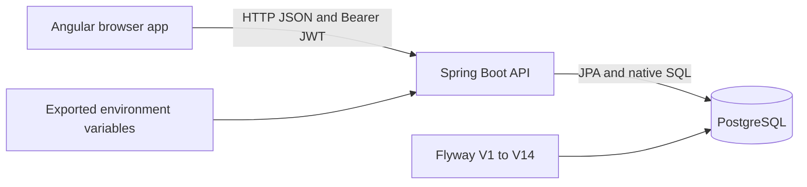
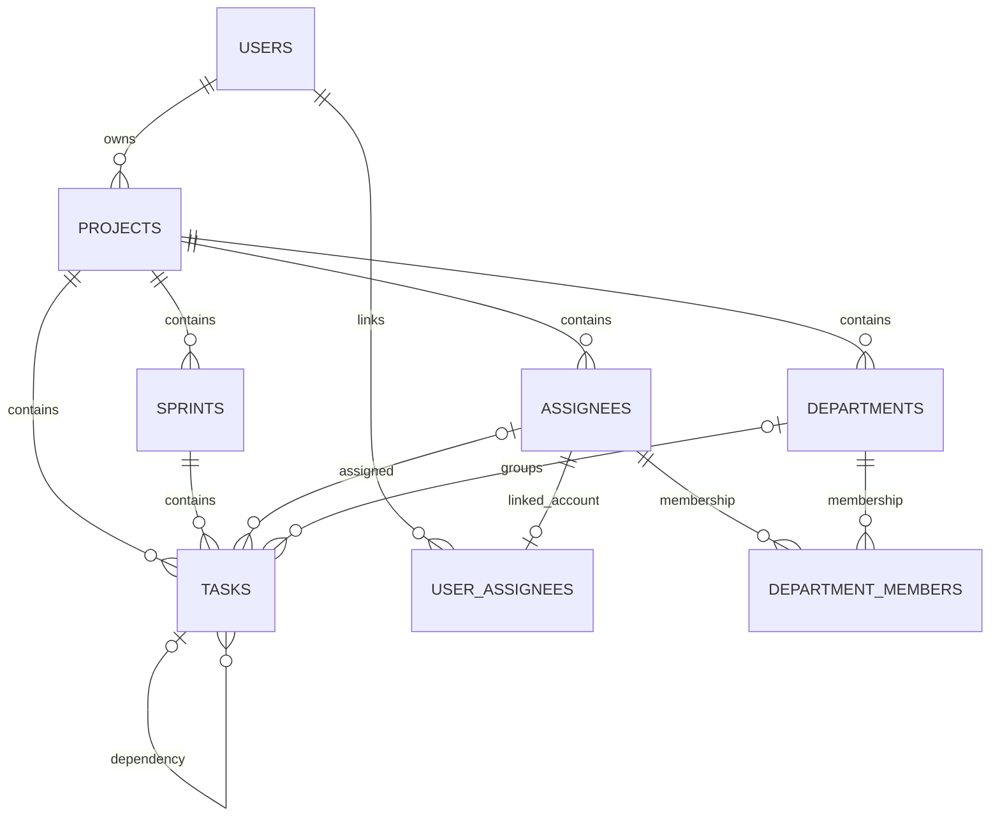

# Architecture and source map

The repository contains a browser SPA, an HTTP API, and a PostgreSQL database. Each application has its own dependency/build configuration.

## Frontend

All frontend paths below are relative to `scrum-app-ui/`.

| Path | Responsibility |
| --- | --- |
| `src/main.ts`, `src/app/app.ts` | Bootstrap and root component |
| `src/app/app.config.ts` | Zoneless change detection, router, HTTP interceptors, animations |
| `src/app/app.routes.ts` | Lazy feature routes and contextual guards |
| `src/app/core/services/` | Typed HTTP integration, auth, layout context, toasts, connectivity |
| `src/app/core/guards/` | Login, role selection, project resolution, assignee/sprint navigation |
| `src/app/core/interceptors/` | JWT header and HTTP error handling |
| `src/app/shared/interfaces/index.ts` | API models, request shapes, enums, timeline/dropdown types |
| `src/app/shared/components/` | Dropdowns, draggable modal, toast UI, user menu |
| `src/app/features/auth/` | Login, registration, role selection, assignee enrollment |
| `src/app/features/projects/`, `features/dashboard/` | Project list/CRUD and project totals |
| `src/app/features/layout/` | Manager navbar, sidebar, and main layout |
| `src/app/features/masters/` | Assignee and department management |
| `src/app/features/sprints/` | Sprint modal, backlog, summaries, manager timeline |
| `src/app/features/assignee/` | Sprint list, sprint layout, dashboard, My Tasks, timeline |
| `src/environments/` | Build-time API URL and toast timeout |
| `src/styles.scss`, `.postcssrc.json` | SCSS, Tailwind 4/PostCSS integration |
| `angular.json` | Build/serve/test targets, production file replacement, budgets/assets |

Components are standalone and generally use signals and computed values for local state. Services use Angular `HttpClient` and return RxJS observables. Some services also expose `BehaviorSubject` state. The project does not use a global store library.

`LayoutService` caches the manager's current project UUID/details and selected sprint. `AssigneeLayoutService` caches the selected assignee sprint. `AuthService` persists the user, access token, refresh token, and per-user role preference in local storage. Context state in services should not be mistaken for authoritative permissions.

The request chain is `jwtInterceptor` followed by `errorInterceptor`. The JWT interceptor adds an Authorization header whenever a stored access token exists. The error interceptor shows toasts; a 401 triggers logout/navigation rather than automatic token refresh.

`ConnectionStatusService` requests the public API health endpoint every 30 seconds. This is connectivity polling; the application does not have a live task event stream.

`MockApiService` remains in the source as a local-storage simulation. The routed features' principal services call the real HTTP API. Do not assume an environment flag switches the whole app to offline mock mode.

## Backend

The application entry point is `ScrumAppApiApplication.java`; Java package paths below are relative to `scrum-app-api/src/main/java/com/scrumku/scrumapp/`.

| Package | Responsibility |
| --- | --- |
| `config/` | Security filter chain, CORS, JWT configuration/signing key |
| `auth/` | JWT filter, account authentication, current user, enrollment and roles |
| `master/project/` | Owned projects, project summary, key generation/encryption |
| `master/assignee/` | Assignee records, display-code counters, manager task/capacity summary |
| `master/department/` | Departments, members, priorities, manager task/capacity summary |
| `sprint/` | Sprint CRUD, holiday/date model, manager timeline |
| `task/` | Task CRUD, reorder, dependency validation, counters, assignment queries |
| `assignee/` | Authenticated assignee sprint list, overview, pages, status, timeline |
| `common/` | API envelope, error/health DTOs, scoped dropdowns |
| `exception/` | Global validation/authentication/authorization/error handling |

The normal flow is controller → service → repository/database → DTO inside `ApiResponse`. Services handle business validation and transactions. Repositories mix JPA methods with custom native SQL through `EntityManager`; many projections are `Object[]` mapped by position. SQL changes must stay synchronized with row-to-DTO mapping.

Spring Security permits `/api/public/**` and `/actuator/health`, authenticates private API paths, disables CSRF, and uses stateless sessions. `JwtAuthenticationFilter` skips public API paths, verifies JWTs, loads the account by email, and establishes the security context. `SecurityUtils` resolves the current user UUID for controllers. Project ownership and assignee access are enforced in services/repository predicates, not via a manager role authority in the filter chain.

## Persistence

`src/main/resources/db/migration/` contains V1–V14. The main configuration uses Flyway validation/baseline support and JPA `ddl-auto: validate`; application startup does not replace the PostgreSQL schema with Hibernate-generated tables.

Sprint holidays are PostgreSQL JSONB. Native SQL uses PostgreSQL-specific aggregation, casts, upserts, tuple comparisons, partial indexes, and date arithmetic. H2 appears as a runtime dependency with a test profile, but does not establish portability for these operations.

Most persisted domain entities have `@Version` and audit fields. Some native updates bypass JPA version handling. Check both entity and SQL update paths when modifying concurrent writes.

## Project enrollment keys

`ProjectKeyEncryptionService` generates a random alphanumeric key. The owner-facing project service encrypts it with AES-GCM using a random IV and the configured hexadecimal master key, stores the encrypted value, records expiration, and stores a deterministic HMAC-SHA256 digest for lookup. Owner responses decrypt keys for display.

Enrollment computes the same digest from the submitted plaintext key and checks expiration before linking an account. Rotating a project enrollment key updates that project's key/digest/expiry. Rotating the master encryption key is a separate operational change: existing ciphertext and digests depend on the previous master key.

V14 adds a nullable digest column without a data backfill. Existing project keys created before that migration may need regeneration/backfill before enrollment lookup succeeds.

## Integration contracts

- Development UI API URL: `http://localhost:8080/api`; UI origin: `http://localhost:4200`.
- Production UI API URL is currently baked into `environment.prod.ts` as `https://scrum-api.brilliand.cloud/api`.
- API public endpoints use `/api/public/v1`; private endpoints use `/api/private/v1`.
- Project UI URLs contain a code; resource API URLs contain UUIDs.
- The API envelope is generic. `@JsonInclude(NON_NULL)` omits null fields, including absent `data`/`error`.
- HTTP services must inspect `success` and available error/data fields as well as transport status.
- Backend dates are `LocalDate` strings; audit timestamps are serialized values, not JavaScript `Date` instances.
- Cursor pagination sorts by task order, priority rank, creation timestamp, and UUID. Consumers must treat the cursor as opaque.

See [API contracts](api.md) and [known gaps](known-gaps.md) before changing these behaviors.
